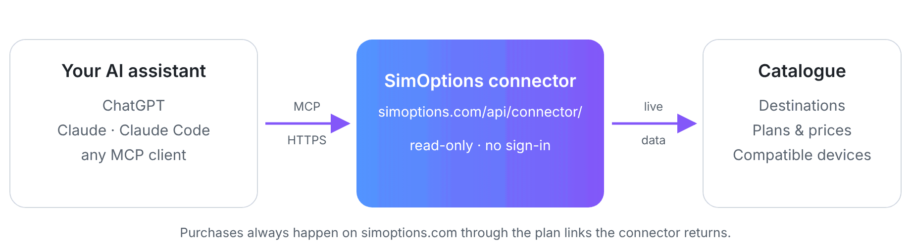

<p align="center">
  <a href="https://simoptions.com">
    <picture>
      <source media="(prefers-color-scheme: dark)" srcset="assets/logo-dark.png">
      
    </picture>
  </a>
</p>

<h3 align="center">Travel eSIM plans, right inside your AI assistant</h3>

<p align="center">
  The official SimOptions connector for ChatGPT, Claude and Claude Code.<br>
  Find destinations, compare eSIM plans and check phone compatibility with live data from <a href="https://simoptions.com">simoptions.com</a>.
</p>

<p align="center">
  <a href="CHANGELOG.md"></a>
  <a href="LICENSE"></a>
  <a href="https://modelcontextprotocol.io"></a>
  
  
  <a href="#claude-code"></a>
</p>

---

## Contents

- [What it does](#what-it-does)
- [How it works](#how-it-works)
- [Connect](#connect)
- [Tools](#tools)
- [Example conversations](#example-conversations)
- [Limits](#limits)
- [Privacy and security](#privacy-and-security)
- [Support](#support)
- [Licence](#licence)

## What it does

Ask your assistant about mobile data for a trip and it answers with SimOptions' live catalogue:

- **Find a destination.** Search the countries and regions SimOptions sells eSIMs for, by name in any language or by code.
- **Compare plans for a trip.** One country or a multi-country itinerary, filtered by trip length and data allowance, with prices in your currency.
- **See what a plan includes.** Validity, data, the networks it runs on in each country, 5G, calls and SMS, and whether it can be topped up.
- **Check your phone.** Find out whether a phone or tablet is on SimOptions' list of eSIM-compatible devices.

Every plan comes with a link to its page on simoptions.com, where the purchase happens. The connector never takes payment, never needs an account and never changes anything.

## How it works

<p align="center">
  <picture>
    <source media="(prefers-color-scheme: dark)" srcset="assets/how-it-works-dark.png">
    
  </picture>
</p>

The connector is a remote [Model Context Protocol](https://modelcontextprotocol.io) server:

| | |
| --- | --- |
| **Server URL** | `https://www.simoptions.com/api/connector/` |
| **Transport** | Streamable HTTP (stateless JSON-RPC 2.0) |
| **Authentication** | None |
| **Access** | Read-only. Every tool is marked `readOnlyHint: true` |

> [!NOTE]
> Use the URL exactly as written, including the trailing slash.

## Connect

### Claude Code

Install it as a plugin from this repository. The plugin adds the connector, an `/esim` command and a trip-planning skill:

```bash
claude plugin marketplace add MWS-HK-SimOptions/public-connector
```

```bash
claude plugin install simoptions@simoptions
```

Or add the server directly:

```bash
claude mcp add --transport http simoptions https://www.simoptions.com/api/connector/
```

Adding the server directly gives you the tools only, without the command and the skill.

Check that it's connected by running `/mcp` inside Claude Code.

#### The `/esim` command

Plan a trip's mobile data in one step:

```text
/esim Japan 10 days
/esim France Italy Spain 2 weeks 10 GB in EUR
```

Claude looks up the destinations, finds the plans that cover the whole trip, recommends the best one or two with their page links, and offers to check your phone.

#### The `esim-trip` skill

The plugin also teaches Claude how to plan a trip's data whenever you ask about it in plain words, without the command. It asks for missing trip details, uses the right destination codes, matches plans to the trip length and data need, and states only facts the tools returned.

### Claude (claude.ai, desktop and mobile)

1. Open **Customize → Connectors** and add a custom connector.
2. Enter `https://www.simoptions.com/api/connector/`. No sign-in is needed.

On Team and Enterprise plans, an Owner adds custom connectors for the organisation.

### ChatGPT

1. Go to [ChatGPT Plugins](https://chatgpt.com/plugins), select the **+** button, then **Add custom MCP server**.
2. Enter `https://www.simoptions.com/api/connector/` as the server URL and choose **No authentication**.
3. Select **Create as a plugin**.

Custom MCP servers depend on your ChatGPT plan and workspace settings.

### Other MCP clients

Point any client that supports streamable HTTP at `https://www.simoptions.com/api/connector/`. No headers or credentials are needed.

To try it from a terminal:

```bash
curl -s https://www.simoptions.com/api/connector/ \
  -H 'content-type: application/json' \
  -d '{"jsonrpc":"2.0","id":1,"method":"tools/list"}'
```

## Tools

### `destinations_search`: Search destinations

Finds the destinations SimOptions sells eSIMs for. It returns up to 10, best match first. A country with no page of its own is answered with the regional plans that cover it.

| Parameter | Type | Required | Description |
| --- | --- | --- | --- |
| `query` | string | yes | Country or region name in any language, or its code: `"Japan"`, `"Europe"`, `"JP"`. At least 2 characters. |

Each result has a `code` (pass it to `plans_find`), `name`, `type` (`country` or `region`), the `countries` it covers and its `pageUrl` on simoptions.com.

### `plans_find`: Find eSIM plans

Lists the plans in stock for a trip. With one destination code it returns the plans that destination's page lists. With several it returns the plans that cover every one of them. Results are sorted cheapest first, at most 20, and `total` says how many matched.

| Parameter | Type | Required | Description |
| --- | --- | --- | --- |
| `destinations` | string[] | yes | 1 to 10 destination codes from `destinations_search`, e.g. `["JP"]` or `["FR","IT","ES"]`. |
| `minDays` | integer | no | Shortest validity accepted, in days. |
| `minDataGb` | number | no | Least data accepted, in GB. Unlimited plans always qualify. |
| `unlimitedOnly` | boolean | no | Only plans with unlimited data. |
| `currency` | string | no | ISO 4217 code, e.g. `"EUR"`. Defaults to the store's currency. |

Each plan includes:

| Field | Meaning |
| --- | --- |
| `id` | The plan's EAN |
| `name`, `operator` | Plan name and network brand |
| `destination`, `coveredCountries` | Where it is sold and every country it works in |
| `validityDays`, `dataGb`, `unlimitedData` | How long it lasts and how much data it has |
| `networks` | The networks it runs on, per country |
| `supports5g`, `calls`, `sms`, `phoneNumber` | Network and phone features |
| `topupsEnabled` | Whether more data can be added later |
| `price` | `currency`, `regular` and `sale` (or `null`) |
| `inStock` | Whether it can be bought now |
| `pageUrl` | The plan's landing page on simoptions.com, where it is bought |

### `devices_check`: Check eSIM compatibility

Checks a phone or tablet against the eSIM-compatible device list that simoptions.com publishes.

| Parameter | Type | Required | Description |
| --- | --- | --- | --- |
| `model` | string | yes | Model name (`"iPhone 15 Pro"`, `"Samsung Galaxy S24"`) or model code (`"SM-S921B"`). |

The answer is `esimCompatible: "yes"` together with the listed model, or `"unknown"`. The list only holds compatible models, so `"unknown"` is not a no: the phone's own settings show whether it has an eSIM option.

## Example conversations

> **You:** I'm going to Japan for 10 days. Which eSIM gives me at least 10 GB?
>
> **Assistant:** *calls `destinations_search` with `"Japan"`, then `plans_find` with `["JP"]`, `minDays: 10`, `minDataGb: 10`* and lists the matching plans with their prices, networks and links.

> **You:** Compare eSIMs for a trip to France, Italy and Spain, in euros.
>
> **Assistant:** *calls `plans_find` with `["FR","IT","ES"]` and `currency: "EUR"`* and shows the plans that cover all three countries.

> **You:** Does the Samsung Galaxy S23 support eSIM?
>
> **Assistant:** *calls `devices_check` with `"Samsung Galaxy S23"`* and answers from SimOptions' compatible-device list.

<details>
<summary>Example <code>plans_find</code> response (illustrative values)</summary>

```json
{
  "destinations": ["JP"],
  "currency": "USD",
  "total": 6,
  "plans": [
    {
      "id": "0000000000000",
      "name": "Japan 10 GB",
      "destination": { "code": "JP", "name": "Japan" },
      "coveredCountries": ["JP"],
      "validityDays": 15,
      "dataGb": 10,
      "unlimitedData": false,
      "networks": { "JP": ["Example Network"] },
      "supports5g": true,
      "calls": false,
      "sms": false,
      "phoneNumber": null,
      "topupsEnabled": true,
      "operator": "Example Operator",
      "price": { "currency": "USD", "regular": 19.9, "sale": null },
      "inStock": true,
      "pageUrl": "https://simoptions.com/..."
    }
  ]
}
```

</details>

## Limits

- **Rate limit:** 60 requests per minute per IP address. Over the limit, the server answers HTTP 429 with a `Retry-After` header.
- **Trips:** up to 10 destinations per `plans_find` call.
- **Results:** up to 20 plans per call (`total` gives the full count) and up to 10 destinations per search.
- **Language:** answers use the store's default language.

## Privacy and security

- **No account and no personal data.** The connector asks for no sign-in, cookies or contact details. Your assistant sends only the tool inputs above.
- **Read-only.** No tool can buy, book or change anything. Purchases happen on simoptions.com, under its own terms.
- **No payment details** ever pass through the connector.

See the [privacy policy](https://simoptions.com/privacy-cookie-policy/) and [terms](https://simoptions.com/general-conditions-of-services/).

## Support

- Email: [contact@simoptions.com](mailto:contact@simoptions.com)
- Contact page: [simoptions.com/contact-us](https://simoptions.com/contact-us/)
- Bugs or questions about this connector: [open an issue](https://github.com/MWS-HK-SimOptions/public-connector/issues)

## Licence

The files in this repository are released under the [MIT licence](LICENSE).

The SimOptions name and logo are trademarks of MWS HK Limited and are not covered by the MIT licence.

<p align="center"><sub>SimOptions is operated by MWS HK Limited.</sub></p>
